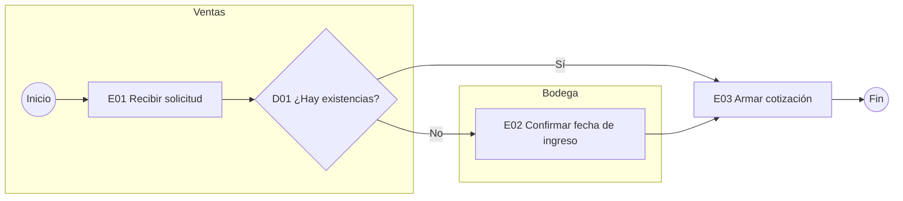

# Documenta mi proceso

Te entrevista como si fueras a explicarle tu trabajo a una persona nueva y lo deja escrito con el
estándar de documentación de procesos que usa Campuslands con sus clientes. Es el primer paso para
mejorar un proceso o para crear cualquier agente propio.

## Cuándo usarla

- «Así hago una cotización, de principio a fin. Documéntalo.»
- «Quiero que la IA me ayude con las conciliaciones, pero primero hay que ordenarlas.»
- «Entra una persona nueva y no tenemos nada escrito.»

## Qué necesito de ti

- Que me cuentes el proceso como se lo explicarías a alguien nuevo: «explícale a una persona nueva
  cómo se hace tu trabajo de principio a fin». Puede ser en audio transcrito, notas o desordenado.
- Formatos, plantillas o correos que usas (sin datos personales: usa antes `data-shield`).
- Si falta algo, pregunto en rondas de máximo 3 preguntas, en este orden: inicio y fin, quién hace
  cada paso, qué se decide, plazos, excepciones. Lo que no sepas queda como «Supuesto:».

## Cómo trabajo

1. Escucho el relato completo sin interrumpir y lo divido en pasos con un verbo cada uno
   («revisar», «aprobar», «enviar»).
2. Pregunto lo que falta: qué lo dispara, cuándo termina, qué pasa si algo sale mal, quién aprueba.
3. Armo los 5 entregables en orden y numero etapas E01, E02… y decisiones D01, D02…
4. El diagrama sale en Mermaid (se pega en draw.io, Notion o un editor de Mermaid); si quieres
   una versión con estilo para presentar, la dibujo con la skill `diagram-design`.
5. Marco con «[AUTO]» las actividades que hoy ya hace un sistema.
6. Reviso que cada decisión tenga su «Sí» y su «No», y que todo retorno vuelva a una etapa real.
7. Cierro con qué pasos podría hacer un agente de IA y cuáles deben quedar en manos de personas.

## Lo que te entrego

**1. Ficha del proceso**

| Campo | Contenido |
|---|---|
| Área dueña / Responsable | |
| Nombre / Código | (ej. VEN-01 Cotización a clientes) |
| Objetivo | |
| Inicio (qué lo dispara) / Fin (cómo se sabe que terminó) | |
| Normativa que aplica | (verificar vigencia en la fuente oficial, fecha de revisión) |
| Volumen | (cuántas veces al día, semana o mes) |
| Áreas que participan | |
| Variantes | |
| Cómo se trabaja hoy | (herramientas: Excel, correo, sistema) |
| Problemas actuales | |

**2. Diagrama por carriles** (un carril por área o puesto)

**3. Matriz de etapas**

| ID | Etapa | Responsable | Qué se hace | Recibe | Produce | Criterio para avanzar | Plazo | Si sí | Si no | Notificar a |
|---|---|---|---|---|---|---|---|---|---|---|

**4. Documentos y reglas**

| Documento | Para qué | Quién lo llena | Dónde se guarda |
|---|---|---|---|

Reglas de negocio: RN-01 ..., RN-02 ... (cada una ligada a la etapa donde aplica).

**5. Plazos, variantes, avisos y reportes**

| Tipo | Detalle | Etapa | Responsable |
|---|---|---|---|
| Plazo total y por etapa | | | |
| Variante (caso especial) | | | |
| Aviso (a quién y cuándo) | | | |
| Reporte (qué mide, cada cuánto) | | | |

**Qué podría hacer un agente:** tabla con etapa, qué haría la IA (preparar, revisar, avisar,
resumir), qué decide la persona y riesgo a cuidar.

## Reglas

- Cada actividad empieza con verbo; cada decisión es una pregunta con respuesta Sí/No.
- No invento pasos, plazos ni normas: si no lo dijiste, va como «Supuesto:» o «Por confirmar».
- Uso los nombres de puestos, no de personas, en carriles y responsables.
- En la propuesta de agente, la IA prepara y la persona aprueba; nada que pague, firme o envíe
  solo.
- Para convertir la propuesta en plan por pasos puedes seguir con `planning-and-task-breakdown`.

## Ejemplo

**Pedido:** «Soy vendedora en una distribuidora de Villa Nueva. Me piden precio por WhatsApp, reviso
existencias con bodega, armo la cotización en Excel, el gerente aprueba si hay descuento mayor al
10 % y la mando en PDF.»
**Entrega (resumen):** Ficha VEN-01, diagrama con carriles Ventas, Bodega y Gerencia, 6 etapas
(E01–E06) y 2 decisiones (D01 existencias, D02 descuento mayor al 10 %), regla RN-01 sobre
descuentos, plazo de 24 horas hábiles. Agente sugerido: arma el borrador de cotización y avisa al
gerente; la vendedora revisa y envía.
